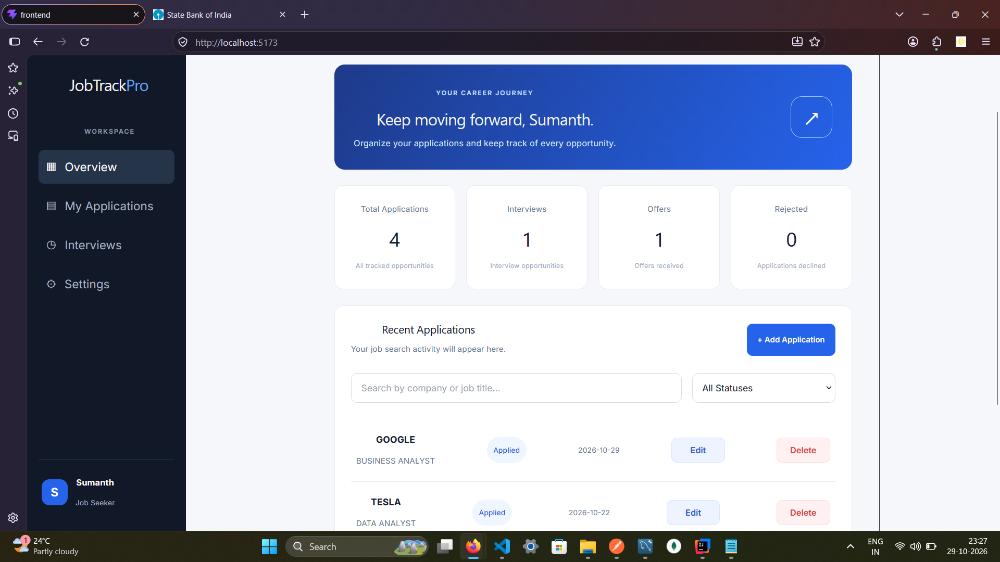

# JobTrackPro — Job Application Tracker

JobTrackPro is a Java full-stack web application that helps job seekers organize and track their job applications in one place.

## Screenshots

### JobTrackPro Dashboard



## Features

- Dashboard with application statistics
- Add, edit, and delete job applications
- Search applications by company name or job title
- Filter applications by status
- View scheduled interviews
- Settings page with filter reset functionality
- Responsive interface for desktop and mobile devices

## Technologies Used

**Frontend**
- React
- JavaScript
- HTML5
- CSS3
- Vite

**Backend**
- Java
- Spring Boot
- Spring Data JPA
- REST APIs

**Database**
- MySQL

**Development Tools**
- IntelliJ IDEA
- Visual Studio Code
- Postman
- Git and GitHub

## Running the Project Locally

### Prerequisites

- Java JDK
- Node.js and npm
- MySQL Server
- IntelliJ IDEA or another Java IDE
- Visual Studio Code or another code editor

### 1. Configure the Database

Create a MySQL database and configure the database connection in the backend's `application.properties` file.

Use your own database credentials. Do not upload passwords or other secrets to GitHub.

### 2. Run the Backend

1. Open the backend project in IntelliJ IDEA.
2. Ensure the MySQL server is running and the database configuration is correct.
3. Run the Spring Boot application.
4. The backend is expected to run at `http://localhost:8080`.

### 3. Run the Frontend

1. Open a terminal in the `frontend` directory.
2. Install the dependencies:

   ```bash
   npm install
   ```

3. Start the development server:

   ```bash
   npm run dev
   ```

4. Open the local URL shown in the terminal, usually `http://localhost:5173`.

## API Endpoints

| Method | Endpoint | Description |
|---|---|---|
| GET | `/api/job-applications` | Retrieve job applications |
| GET | `/api/job-applications/stats` | Retrieve dashboard statistics |

The API runs locally when the Spring Boot backend is running.

## Project Status

Core application features have been implemented and tested locally. Production deployment status should be verified separately.

## Author

**Sumanth**
